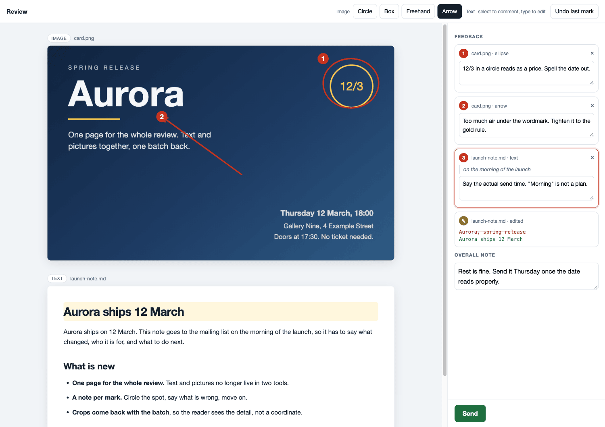
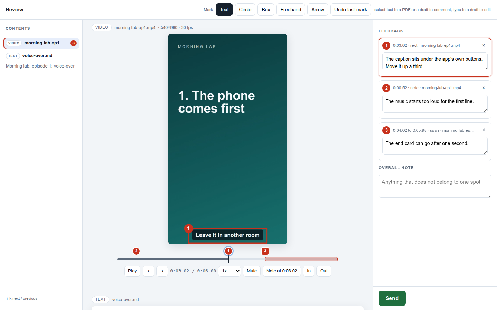

# human-review

An agent that asks "does this look right?" in chat gets "looks good" back. Prose about a draft is not
the draft. This skill puts the draft itself in a browser. The reviewer edits the words, selects any
phrase and comments on it, and circles the part of the image that is wrong. One Send button returns
the whole batch.

Text and pictures sit on the same page on purpose. A draft is rarely only prose or only an image. An
invitation is a rendered card and its copy. A post is text and its hero image. Two surfaces split the
reviewer's attention. They also cost a round every time an item crosses the boundary.



One card, one draft, four items back. Everything in the picture is invented, and
[`scripts/make_example_inputs.py`](scripts/make_example_inputs.py) rebuilds the two files behind it.

A video works the same way. Pause it, circle what is wrong on the frame, or note a moment or a span
of time. The batch brings back each moment's frame with the marks drawn in.



A box on a frame, a note on the sound, a span over the end card. `make_example_inputs.py --video`
rebuilds the Short and its script.

## The loop

```sh
skills/human-review/bin/review open draft.md card.png form.pdf   # opens the page, returns at once
skills/human-review/bin/review open short.mp4 voice-over.md      # a video with its script
skills/human-review/bin/review poll --session <id>               # blocks until they hit Send
skills/human-review/bin/review poll --ack                        # clears the batch you handled
skills/human-review/bin/review status                            # is a batch waiting
skills/human-review/bin/review close                             # stop a review nobody sends
skills/human-review/bin/review selftest [--browser]              # 163 offline cases, 189 more in Chrome (wide and phone)
```

1. Write or render the draft.
2. Open it with `open`. The command prints a session id and a `127.0.0.1` URL. It also copies the URL
   to the clipboard and opens a browser. Nothing leaves the machine. The server is local, the page is
   local, and no account is involved.
3. Wait for `poll`. It blocks until Send, then prints the batch as JSON. **Do not busy-wait, and do
   not add a timeout loop.** Some harnesses can run a command in the background and wake you when it
   exits. Use that, and end your turn. Otherwise keep the foreground poll alive inside the turn.
4. Apply the batch, render again, and offer the next round on the new file. Two or three tight rounds
   beat one long round.

## What the reviewer can do

| On                             | How                                               | What you get back                                                          |
| ------------------------------ | ------------------------------------------------- | -------------------------------------------------------------------------- |
| An image or a PDF page         | circle, box, freehand or arrow, one note per mark | the picture with the marks rendered into it, plus one padded crop per mark |
| A PDF page                     | select the words themselves, click Comment        | the same, plus the exact quote, its anchor and one rectangle per line      |
| A Markdown, HTML or text draft | select any text, across paragraphs too, click Comment (or Ctrl+Alt+M), type the note | the quote with a prefix and suffix anchor, and the block it sits in. A selection over several paragraphs also lists them in `blocks` |
| The same draft                 | type straight into it                             | a before and after per block                                               |
| The same draft                 | circle, box, freehand or arrow, one note per mark | the `tool`, the marked words as `quote`, their block and a `box`. No crop, and an empty anchor |
| A video                        | pause it, then circle, box, freehand or arrow on the frame | the moment `t` and its `timecode`, the frame with the marks of that moment drawn in, and one padded crop per mark |
| The same video                 | Note at (or `n`) for a moment, `i` and `o` for a span | the moment, or a span from `t` to `t_end` with the frame at each end |

Every item lands in one numbered list. Their "2" is your "2", on a picture, in a paragraph and on a
video alike.

A PDF is drawn page by page by PDF.js, at the pixel ratio of the screen, so it is as sharp as a PDF
viewer and its text behaves like text: selectable, copyable, and findable with the browser's own
Ctrl+F across every page of the session. Every crop of a PDF page is re-rendered from the file at up
to eight times page size, so six-point type in a footnote is legible in the crop.

## Reviewing a video

`open` takes `.mp4`, `.m4v`, `.mov` and `.webm`. A file that every browser plays (H.264 8-bit in
MP4, VP8 or VP9 in WebM) is staged as it is. A QuickTime file with those streams is rewritten as MP4
without re-encoding. Anything else (HEVC, AV1, ProRes, 10-bit, PCM sound) is converted once to
H.264 and AAC with ffmpeg, and `open` says so. The conversion is kept in the session under the
file's hash, so the next round on the same render starts at once.

The picture fits the height of the window, so a 9:16 Short is seen whole. Under it are a timeline
with one numbered marker per note, Play, one frame back and on, the speed (0.25x, 0.5x, 1x), Mute,
Note at, In and Out.

- **Drawing pauses the video.** The mark belongs to the frame on screen. It shows only while the
  playhead sits on that frame, and a click on its marker or its note goes back there.
- **Every pause and seek lands on the middle of a frame**, so the frame on screen, the time a mark
  records and the frame Send exports are one frame.
- **A note needs no drawing.** Note at (or `n`) is for the sound, the pacing or a cut.
- **A span is two key presses.** `i` where it starts, `o` where it ends. Escape drops a started span.
- **The player's keys work only while it has focus**, so `j`, `k` and `o` keep their meaning
  everywhere else: Space plays and pauses, `,` and `.` or the arrow keys step one frame,
  Shift+arrow one second, Home and End go to the first and last frame. Escape in a note on a video
  gives the keys back to the player.
- A tap on the picture that draws nothing plays or pauses it.

## Finding the way around a long session

A session of ten documents and eighty pages is 100,000 pixels of scroll. From two documents on (or
one document with two pages or two headings) a contents list appears at the top left: every
document with its kind, its page count and how much feedback sits on it, one chip per page, and the
headings of a draft. The entry you are reading is marked, and the counts move as notes are written,
so the list is also a map of where the feedback is.

- `j` and `k` go to the next and previous stop, `o` shows and hides the list, `Esc` closes a drawer.
  None of them fires while the caret is in a note or in an editable block.
- In a draft, Shift+Arrow carries a selection on past the end of a paragraph, and Ctrl+Alt+M
  (Cmd+Option+M on a Mac) comments on it, so a comment over several paragraphs needs no mouse.
- Inside the list: arrow keys, Home, End, Enter.
- **No jump touches the browser history**, because a page may only close its own tab while that tab
  has one history entry, and Send closes the tab.
- Below 1200 px the list is a drawer behind a Contents button. Below 760 px the feedback list is a
  drawer too, the document gets the whole width, and a bottom bar carries Feedback and Send. That is
  the phone layout, and it is checked at 390x844 by `selftest --browser`.

## The batch

```json
{
  "status": "feedback",
  "session": "0281f317ca76",
  "pages": [
    {
      "kind": "media",
      "name": "card.png",
      "source": "/abs/card.png",
      "overview": "/…/overview_card.png",
      "marks": [
        {
          "number": 1,
          "tool": "ellipse",
          "note": "head smaller",
          "box": { "x": 0.3, "y": 0.05, "w": 0.4, "h": 0.17 },
          "crop": "/…/crops/card_mark_01.png"
        }
      ]
    },
    {
      "kind": "media",
      "name": "statement.pdf, page 2",
      "source": "/abs/statement.pdf",
      "document": "statement.pdf",
      "page": 2,
      "pages": 3,
      "overview": "/…/overview_d2_statement_p02.png",
      "marks": [
        {
          "number": 2,
          "tool": "text",
          "note": "this total is wrong",
          "quote": "1.234,56 EUR",
          "anchor": { "prefix": "Interest ", "suffix": " for the period" },
          "rects": [{ "x": 0.19, "y": 0.22, "w": 0.09, "h": 0.02 }],
          "box": { "x": 0.19, "y": 0.22, "w": 0.09, "h": 0.02 },
          "crop": "/…/crops/d2_statement_p02_mark_02.png"
        }
      ]
    },
    {
      "kind": "text",
      "name": "draft.md",
      "source": "/abs/draft.md",
      "edits_saved": false,
      "comments": [
        {
          "number": 2,
          "quote": "…",
          "anchor": { "prefix": "…", "suffix": "…" },
          "block": "draft#4",
          "note": "cut this"
        },
        {
          "number": 3,
          "quote": "the last sentence of one paragraph\nThe first words of the next",
          "anchor": { "prefix": "…", "suffix": "…" },
          "block": "draft#5",
          "blocks": ["draft#5", "draft#6"],
          "parts": [
            { "block": "draft#5", "quote": "the last sentence of one paragraph" },
            { "block": "draft#6", "quote": "The first words of the next" }
          ],
          "note": "merge these"
        },
        {
          "number": 4,
          "tool": "ellipse",
          "quote": "Second heading",
          "anchor": { "prefix": "", "suffix": "" },
          "block": "draft#7",
          "box": { "x": 0.08, "y": 0.41, "w": 0.35, "h": 0.04 },
          "note": "shorter"
        }
      ],
      "edits": [
        { "block": "draft#2", "label": "h2", "before": "…", "after": "…" }
      ]
    }
  ],
  "overall_note": "the rest is fine"
}
```

A video is one page of its own kind. This one is from the session in the second picture:

```json
{
  "kind": "video",
  "name": "morning-lab-ep1.mp4",
  "source": "/abs/morning-lab-ep1.mp4",
  "duration": 6.0,
  "fps": 30.0,
  "width": 540,
  "height": 960,
  "marks": [
    {
      "number": 1,
      "tool": "rect",
      "note": "The caption sits under the app's own buttons. Move it up a third.",
      "t": 3.017,
      "timecode": "0:03.02",
      "frame_number": 90,
      "box": { "x": 0.17, "y": 0.925, "w": 0.66, "h": 0.07 },
      "frame": "/…/frames/d1_morning_lab_ep1_at_00003017ms.jpg",
      "crop": "/…/crops/d1_morning_lab_ep1_mark_01.png"
    },
    {
      "number": 2,
      "tool": "note",
      "note": "The music starts too loud for the first line.",
      "t": 0.517,
      "timecode": "0:00.52",
      "frame_number": 15,
      "frame": "/…/frames/d1_morning_lab_ep1_at_00000517ms.jpg"
    },
    {
      "number": 3,
      "tool": "span",
      "note": "The end card can go after one second.",
      "t": 4.017,
      "timecode": "0:04.02",
      "frame_number": 120,
      "t_end": 5.983,
      "timecode_end": "0:05.98",
      "frame_number_end": 179,
      "frame": "/…/frames/d1_morning_lab_ep1_at_00004017ms.jpg",
      "frame_end": "/…/frames/d1_morning_lab_ep1_at_00005983ms.jpg"
    }
  ]
}
```

### Rules for reading it

- **Open every `crop`.** This is the point of the media path. A box at `0.30, 0.05` tells you
  nothing. The crop shows you the eyebrow, the kerning, the seam you got wrong. Look at the images if your model can see them. Say so rather than guess from
  coordinates if it cannot.
- **Open the `overview` first.** It shows what they saw while they wrote the notes.
- **A page of a PDF carries `document`, `page` and `pages`,** and its `name` is the label the
  reviewer saw ("statement.pdf, page 2"). `source` is still the PDF itself, so three marked pages of
  one file give three entries with one `source`. A page of a PowerPoint deck also keeps `slide`.
- **A mark with `"tool": "text"` is a selection, not a drawing.** It carries the exact `quote`, its
  `anchor` and one rectangle per line in `rects`, with `box` as their union. Use the quote to find
  the words in the source the PDF was made from, and read the crop to see them in place.
- **A comment with `blocks` spans several paragraphs.** Read `parts`: one `{block, quote}` per
  paragraph, in order. `quote` joins them with newlines for display only, and a code block can hold
  newlines of its own, so do not split it back. The `prefix` comes from the first block and the
  `suffix` from the last.
- **A comment with a `tool` was drawn on a draft, not selected.** Its `quote` is the marked words as
  the page showed them, from the first marked word to the last in each block, one line per block.
  Its `anchor` is empty, because a shape has no exact character span, so the same phrase twice in
  one block is ambiguous. `box` is where the shape sat, as fractions of the draft. An arrow quotes
  the word at its head. An empty `quote` means the shape sat on no words; `block` still names the
  block nearest to it. Over several paragraphs it has `blocks` and `parts` like a selection. A mark
  is read when it is drawn, so later edits do not change its quote.
- **On a video, open every `frame`.** It is the frame they saw, with the marks of that moment drawn
  in. Notes on one frame share one file. `t` is in seconds, and `timecode` is the same moment as
  `M:SS.cc`.
- **`t` is the middle of its frame, so do not hand it to `ffmpeg -ss`.** `-ss` takes the first frame
  at or after a time, which is the next one. For the frame without marks, give it the start of the
  frame: `ffmpeg -ss <frame_number / fps> -i <file> -frames:v 1 clean.png`.
- **`t` is on the copy the browser played.** That is `source` itself, unless the page carries
  `played` and `converted`: then use `played` for frames and timings. A conversion keeps the timing,
  so `t` also finds the moment in the source.
- **`frame_number` counts from 0 at the average frame rate.** On a phone or screen recording the rate
  varies, so treat the number as close and `t` as exact.
- **A `note` has no box and no crop. A `span` has `t_end`, `timecode_end` and `frame_end`** too.
  `frame` is null when the browser could not show that frame. `past_end: true` means the note was
  made on a longer version of the file, so that moment is not in this one and it has no frame: ask
  about it.
- **`source` is the original file.** Edit that file. The copy in the session directory is a working
  copy, and a rewrite of it changes nothing.
- **`edits_saved` is always false.** This tool never writes to their files. Apply `after`
  **verbatim**, and keep the syntax of the source. An edit made in a rendered Markdown block goes
  back into the Markdown, not as HTML.
- **An edit is their wording, not a suggestion.** Never revert it, and never improve it. Say so and
  show the evidence if it introduces an error of fact. The wording is still theirs to decide.
- **A mark with an empty note means "look here".** Ask what is wrong. Do not invent a reason.
- **Answer in your own channel, never in the tool.** The page has no chat. They see the result when
  you render again.
- Keep their numbering when you report back: "1 done, 2 done, 3 needs a decision".

`marks.md` in the session directory carries the same batch as plain text. `receipt.json` records the
files and the time. A later gate can then treat "a human looked at this" as a fact.

## Triage before you implement

A batch is not a task list. Sort every item into one of three buckets, and say which one, before you
touch anything:

- **do it now**,
- **defer**, and write the item down somewhere durable in the same turn,
- **reject**, with the reason in one line.

Two failure modes look like diligence:

- **You implement a comment you do not understand.** Ask. One question now is cheaper than a round on
  the wrong fix.
- **You drop the awkward item in silence.** Say that you disagree, then do it anyway. The one
  exception is an item that is wrong on the facts.

## Where it fits

Run the machine checks first: types, tests, linters, and any automated review you have. Then look at
the rendered draft yourself, with your own eyes. Only then spend a human's attention. Their time is
the most expensive input in the loop. Do not spend it on a defect a tool can find.

## Requirements and limits

- **Python 3.9 or newer, standard library only.** No pip, no npm, no Node. It works offline.
- The browser renders the marked-up overview and cuts the crops, so the tool needs no image library.
- **One vendored dependency, and only in the browser: PDF.js 6.3.289** (Apache-2.0), in
  [`assets/vendor/pdfjs`](assets/vendor/pdfjs/). Pinned, checksummed in `SHA256SUMS`, verified by
  `selftest`, served from `127.0.0.1`, never fetched. The upstream URL, what is deliberately left
  out, and the update procedure are in its [README](assets/vendor/pdfjs/README.md). No renderer has
  to be installed any more: poppler and `sips` are gone.
- **What the vendored subset cannot draw.** A scan compressed with JPEG 2000 or JBIG2 needs decoders
  that are shipped as wasm, which this repository does not carry, so such a page comes up blank. A
  CJK PDF without embedded fonts can show empty glyphs. A PDF that names Helvetica, Times or Courier
  without embedding them is drawn with the machine's own fonts, as every other viewer does.
- **The page is locked down, and that is visible in one place.** The server sends
  `default-src 'none'` with a fresh nonce for its two scripts, so a reviewed HTML draft can no longer
  run an `onclick=` handler or a `javascript:` link, and `img-src 'self'` means a **remote image
  inside a reviewed draft does not load**. Inline it, or review a screenshot, if you need to see it.
  `media-src 'self'` lets the page play the session's own video and nothing else.
- A PowerPoint deck (.pptx) or Word document (.docx) needs LibreOffice (`soffice`) to become a PDF first.
  Password-protected decks and documents are detected and skipped cleanly.
- Word (.docx) review limits: Word comments are not rendered, tracked changes show as the document last displayed them, and a Word file is reviewed by marking and commenting, not retyping.
- The Markdown renderer is a deliberate **subset**: headings, lists, quotes, code, tables, links,
  emphasis. Anything else stays a paragraph, and nothing disappears. Full CommonMark needs a
  dependency, and a draft review does not need it.
- The tool reviews **files**. A page from a development server is out of scope. Screenshot it, or
  review the template behind it.
- **Video needs ffmpeg only for a file that not every browser plays**, and ffprobe for the frame rate.
  Without them a file is staged as it is, `fps` is null, and a frame step is 1/30 s. If the browser
  then cannot play the file, the page says so, and a note on it is still sent, without a frame.
- **HDR footage is converted without tone mapping**, so it looks pale. Review an SDR render instead.
- **A conversion runs at `open`.** A long 4K master takes minutes once, and nothing on the next
  round of the same file.
- **The server answers byte ranges for video**, which Safari needs to play it at all and every
  browser needs to seek. It serves several requests at once, so a download the browser holds open
  cannot hold up a draft save or Send.
- **Send closes the tab.** A browser lets a page close its own tab only while the tab has one
  history entry. A review opened in a tab that already showed a page cannot close itself. On macOS
  the server then closes that tab in Chrome or Edge. It does so only when the app the agent runs in
  already has Automation permission for that browser. It never asks for that permission. Without
  it, the page says the review is finished, and the tab stays open. The server stops by itself
  after Send. Do not run `close` then, or the tab can stay open.
- The server answers only requests addressed to `127.0.0.1` or `localhost`, and it takes a POST
  only from its own page. Another web page cannot send a batch or read a draft. A port forward
  keeps working.
- Sessions live in `~/.claude/.review/<id>/`. Delete the directory to discard one.

## Credit

PDF pages are drawn and made selectable by [PDF.js](https://github.com/mozilla/pdf.js) (Apache-2.0),
vendored unmodified. The page carries about twenty lines of its `web/pdf_viewer.css`, marked as such
in [`assets/review.html`](assets/review.html), because its text layer needs them.

Two ideas come from [human-review](https://github.com/petergyang/human-review) by Peter Yang (MIT).
The first anchors a selection by prefix, quote and suffix rather than by offset. The second reports
an edit as a before and after on one block, instead of a diff of the whole document. The
implementation here is independent, and the two projects share no code.
